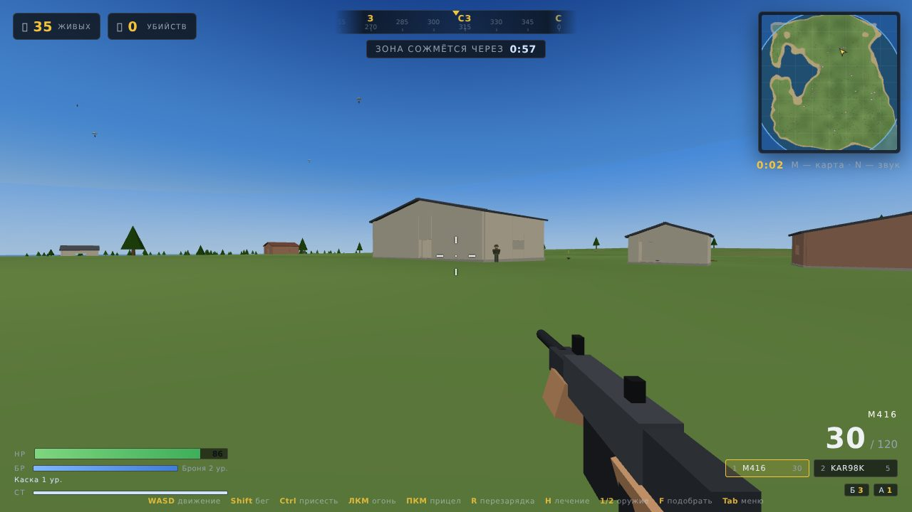
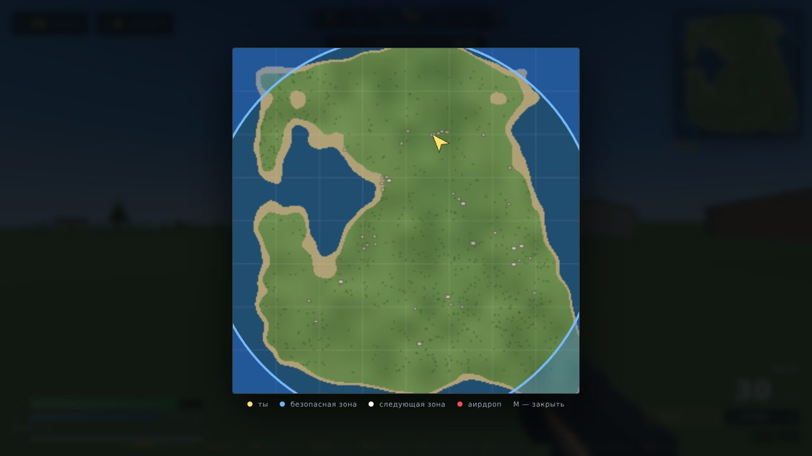

# PUBG: Web Edition

Королевская битва в браузере: остров 1.6 × 1.6 км, самолёт, парашют, лут, 34 бота, синяя зона и аирдропы.
Ничего не нужно скачивать и устанавливать — открыл ссылку и играешь. Полезно, если ПК слабый
или лень качать 50 ГБ.

**Играть:** https://s4rgeant1k.github.io/pubg_web-edition/



## Что внутри

| Механика | Как сделано |
|---|---|
| Самолёт и десант | Случайный маршрут над островом, прыжок по `F`, свободное падение, парашют |
| Остров | Процедурный рельеф, 6 посёлков и хутора: ~39 домов с дверями, окнами, перегородками и мебелью |
| Лут | 7 стволов (M416, AKM, SCAR-L, UMP45, S686, Kar98k, P92), патроны 5 калибров, броня и каски 1–3 ур., аптечки |
| Стрельба | Хитскан с разбросом, отдача, прицеливание, снайперский скоп, дробовик с 9 дробинами, урон по голове |
| Боты | 34 противника: десантируются, собирают лут, патрулируют, стреляют очередями, лечатся, бегут от зоны, воюют друг с другом |
| Синяя зона | 7 фаз сжатия с уроном вне круга, круг следующей зоны на карте |
| Аирдроп | Ящик с топ-лутом и красным лучом, приманка для боя |
| Победа | «Курица на ужин» за последнего выжившего, экран смерти с местом в матче |

Все модели, текстуры и звуки генерируются кодом — в проекте нет ни одного мегабайта ассетов,
поэтому загрузка занимает секунды даже на мобильном интернете.



## Управление

| Клавиша | Действие |
|---|---|
| `WASD` | Движение |
| `Shift` | Бег (тратит выносливость) |
| `Ctrl` / `C` | Присесть |
| `Space` | Прыжок |
| ЛКМ / ПКМ | Огонь / прицеливание |
| `R` | Перезарядка |
| `H` | Лечение (медкит → аптечка → бинт) |
| `1` / `2`, колесо | Смена оружия |
| `F` | Прыжок из самолёта, раскрыть парашют, подобрать лут |
| `M` | Большая карта |
| `Tab` | Пауза |
| `N` | Звук вкл/выкл |
| `F3` | Счётчик FPS |

## Как запустить локально

Игра статическая (ES-модули + Three.js), нужен только http-сервер — открывать `index.html`
через `file://` нельзя, браузер заблокирует модули.

```bash
python3 serve.py 8000     # → http://localhost:8000
# или
npx serve .
```

## Структура

```
index.html        разметка HUD и экранов
styles.css        интерфейс в стиле батл-рояля
js/main.js        точка входа, настройки в localStorage
js/game.js        игровой цикл, правила матча, стрельба, самолёт, аирдроп
js/world.js       рельеф, посёлки, дома, деревья, коллизии, пространственный индекс
js/player.js      физика от первого лица, оружие, инвентарь, модель оружия
js/bots.js        ИИ ботов и модель солдата
js/zone.js        фазы синей зоны
js/items.js       оружие, лут, дроп
js/hud.js         интерфейс, киллфид, подсказки
js/minimap.js     мини-карта и большая карта
js/audio.js       синтез звука на WebAudio
js/input.js       клавиатура/мышь, pointer lock
vendor/three.module.js  Three.js r160 (MIT), локально — без CDN
tools/check.mjs   проверка модулей, id и офлайн-режима
tools/sim.mjs     безголовый прогон логики: мир, боты, зона, стрельба
tools/browser-check.mjs  дым-тест в headless Chromium
```

## Производительность

Игра рассчитана на слабые и средние ПК:

* статические стены и ящики собраны в `InstancedMesh`, деревья — два инстанс-меша;
* один предмет лута и один солдат — одна геометрия с запечёнными цветами (один draw call);
* коллизии и попадания идут через пространственную сетку, а не перебор всех объектов;
* проверка видимости ботов — не чаще 3 раз в секунду на бота;
* качество графики переключается в настройках, при просадке ниже 28 FPS движок сам снижает
  разрешение рендера;
* нет текстур и звуковых файлов — только процедурная генерация.

## Проверки

```bash
node tools/check.mjs   # импорты, все id из HTML, отсутствие внешних запросов
node tools/sim.mjs     # 4 минуты матча без браузера: боты, зона, стрельба, NaN
```

Браузерный дым-тест (нужны `npm i --no-save puppeteer-core @sparticuz/chromium`):

```bash
node tools/browser-check.mjs http://127.0.0.1:8000/
```

## Деплой на GitHub Pages

Репозиторий уже подготовлен: в корне лежит `.nojekyll`, все пути относительные.
Pages настроены на публикацию из корня ветки `main` — после мержа пулл-реквеста игра
обновится на https://s4rgeant1k.github.io/pubg_web-edition/ автоматически.

Если нужно переключить источник публикации вручную:
**Settings → Pages → Source: Deploy from a branch → Branch: `main` / `(root)`**.

## Лицензия и правовая заметка

Код — MIT. Three.js — MIT (`vendor/THREE-LICENSE`).
Это фанатская браузерная игра в жанре battle royale: названия оружия и жанр используются
как обозначения, логотипы и ассеты PUBG Corporation / Krafton не используются.
