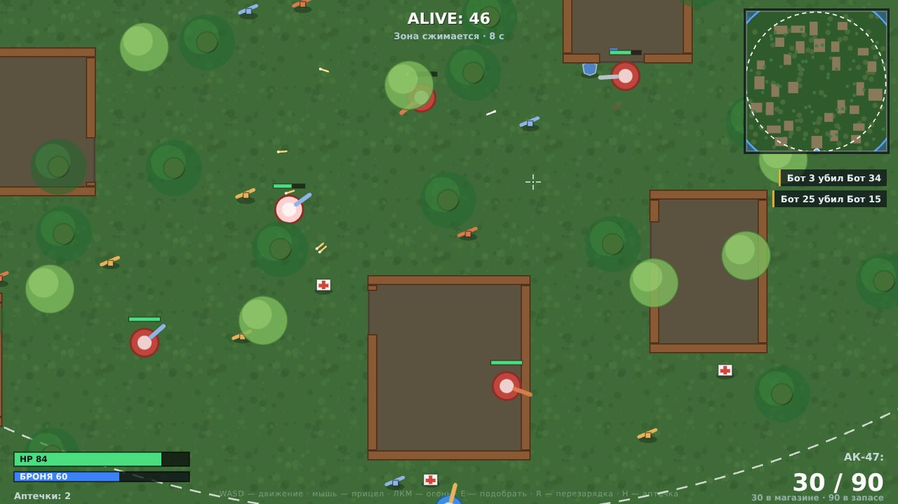

# Battle Royale 2D

Полноценная одиночная королевская битва в браузере в стиле PUBG / Surviv.io:
50 бойцов, карта 3000 × 3000, дома с дверями, деревья, кусты-укрытия, сужающаяся
синяя зона, лут и победа за последнего выжившего.

Вся игра — **один файл `index.html`**: чистый JavaScript, HTML5 Canvas и CSS.
Ни одного внешнего файла, библиотеки или ассета.

**Играть:** https://s4rgeant1k.github.io/pubg_web-edition/


## Управление

| Ввод | Действие |
|---|---|
| `W A S D` / стрелки | Движение (по диагонали скорость нормализуется) |
| Мышь | Прицел — персонаж всегда смотрит на курсор |
| ЛКМ | Огонь (автомат — зажатием, остальные — по клику) |
| `E` | Подобрать предмет в радиусе 40 px |
| `R` | Перезарядка (2.5 с) |
| `H` | Аптечка: 4 секунды неподвижности, +50 HP |

## Что реализовано

**Карта.** Фиксированный мир 3000 × 3000 с пространственной сеткой для быстрых коллизий.
Процедурно генерируются:

* 30 домов 150–300 px со стенами-коробками и одним дверным проёмом (AABB-коллизии, пули стены не пробивают);
* 80 деревьев: ствол радиусом 15 блокирует движение и пули, полупрозрачная крона радиусом 40
  рисуется поверх бойцов и скрывает снаряды;
* 60 кустов радиусом 35: не блокируют, но дают `isInBush` — бот внутри куста не рисуется и не виден другим ботам, игрок становится полупрозрачным;
* 98 предметов лута: оружие, аптечки, бронежилеты.

Центр карты (стартовая точка игрока) всегда остаётся свободным от домов, деревьев и кустов.

**Персонажи.** Класс `Character` с радиусом 20, здоровьем, бронёй, магазином и резервом патронов,
флагами `isDead`, `isHealing`, `isInBush`. Базовая скорость 4, при движении назад или со снайперкой — 2.5.
Бойцы расталкиваются по вектору столкновения и не выходят за границы карты.

**ИИ ботов** — конечный автомат:

| Состояние | Логика |
|---|---|
| `LOOTING` | Ищет ближайшее оружие / аптечку / броню, идёт к цели, подбирает автоматически с 30 px |
| `RUN_TO_ZONE` | Вне круга или у самой границы — бежит к случайной точке внутри следующей безопасной зоны |
| `COMBAT` | Видит цель в радиусе 400 px и по прямой видимости: доворачивается, стреляет очередями сообразно оружию, стрейфит, держит дистанцию |
| `FLEE` / лечение | При HP < 30 и наличии аптечки разрывает дистанцию, прячется в ближайшем кусте и лечится 4 секунды |

Плюс реакция на урон, обход препятствий при застревании и разная «меткость» у каждого бота.

**Оружие.**

| Тип | Урон | Задержка | Магазин | Дальность | Разброс | Скорость пули |
|---|---|---|---|---|---|---|
| Пистолет | 15 | 400 мс | 8 | 500 | 0.05 | 12 |
| Автомат | 20 | 120 мс | 30 | 700 | 0.12 | 16 |
| Дробовик | 12 × 5 дробин | 800 мс | 2 | 300 | 0.35 | 10 |
| Снайперка | 65 | 1500 мс | 5 | 1200 | 0.01 | 25 |

Пули летят с подшаговой проверкой (на большой скорости не «перепрыгивают» цели),
теряют `rangeLeft`, гаснут о стены и стволы. Урон делится 50/50 между бронёй и HP;
после смерти боец выбрасывает оружие с патронами, аптечки и броню.

**Синяя зона.** 5 фаз: 25 секунд ожидания (на мини-карте пунктиром показан следующий круг)
и 20 секунд плавного сжатия. Урон вне круга: 2 → 5 → 10 → 12 → 15 HP/с, броня не защищает.

**Интерфейс.** Полосы HP и брони с цифрами, название оружия и патроны `магазин / запас`,
счётчик `ALIVE`, статус зоны, мини-карта 200 × 200 (синяя точка игрока, синий круг зоны,
белый круг следующей зоны — врагов нет), килл-фид на 4 сообщения с плавным исчезновением,
экран `GAME OVER` с местом и убийствами, анимированный `VICTORY ROYALE!`.

**Звук** синтезируется через WebAudio (выстрелы, попадания, подбор, лечение, победа/поражение) —
ни одного аудиофайла.



## Производительность

* пули, персонажи и препятствия ищутся через пространственные сетки (250 px для статики, 100 px для бойцов);
* рисуется только то, что попало в кадр камеры;
* фон — закешированный `CanvasPattern`, мини-карта — один раз отрисованный offscreen-canvas;
* переиспользуются временные массивы, в игровом цикле нет лишних аллокаций;
* камера следует за игроком с `lerp = 0.1` и не выходит за границы карты.

## Локальный запуск

Достаточно открыть `index.html` — файл автономный, сервер не нужен. Если браузер
блокирует что-то в `file://`, поднимите любой статический сервер:

```bash
python3 -m http.server 8000   # → http://localhost:8000
```

## Деплой

GitHub Pages настроен на публикацию из корня ветки `main` (в репозитории лежит `.nojekyll`).
После мержа изменений игра обновляется на https://s4rgeant1k.github.io/pubg_web-edition/ автоматически.

## Проверено

Игра прогнана в headless Chromium: старт матча, движение, стрельба, подбор лута, лечение,
сжатие зоны, экраны победы и поражения, рестарт — ошибок в консоли нет.
Отдельно проверен баланс: матч 50 бойцов доходит до финала за ~3–4 минуты,
боты дерутся между собой, зона стабильно добивает опоздавших.

## Правовая заметка

Код можно использовать свободно. Это фанатская игра в жанре battle royale:
используются только названия оружия и жанра, логотипы и ассеты PUBG / Krafton не применяются.
